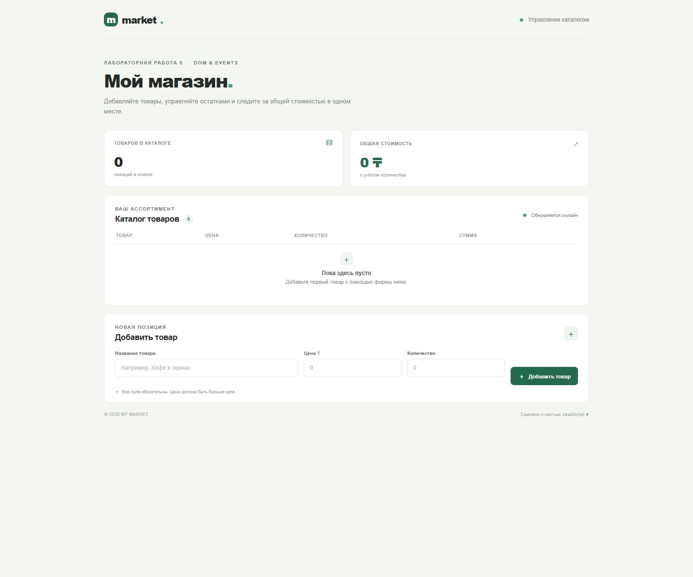

# DOM Store — Lab 5

Интерактивный каталог товаров на чистом JavaScript и DOM API. В `src/Store.js` находится класс `Store` из лабораторной работы 4; `src/store-browser.js` содержит совместимый браузерный вариант того же API, чтобы страницу можно было открыть напрямую как `index.html`.

## Как открыть

Откройте `index.html` в современном браузере двойным щелчком. Страница использует обычные JavaScript-скрипты, поэтому локальный сервер и установка зависимостей не нужны.

## События

Форма слушает событие `submit`, чтобы проверить поля и добавить товар без перезагрузки страницы. Проверка показывает сообщения рядом с неверными полями и не использует `alert`. На всём списке товаров установлен один обработчик `click`: он определяет нажатую кнопку через делегирование и удаляет товар или меняет его количество. После любого успешного изменения список и общая сумма заново отображаются из данных `Store`, поэтому интерфейс остаётся синхронным с моделью.

## Скриншот

## AI-инструменты

При подготовке использовался OpenAI Codex. Код нужно понимать и быть готовым объяснить его на защите.
